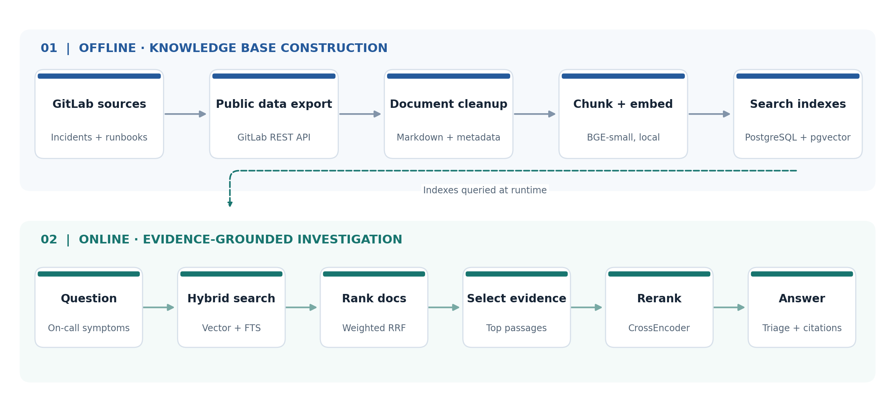
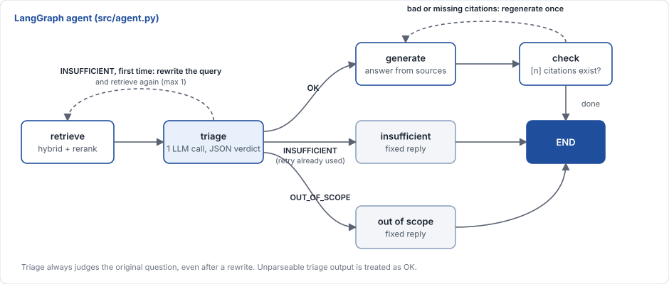
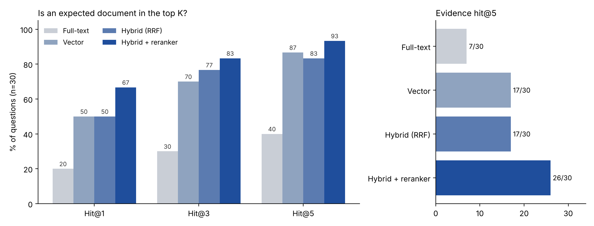
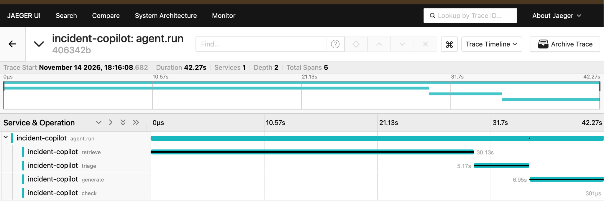

# GitLab Incident Resolution Copilot

**An AI assistant that helps investigate GitLab.com infrastructure incidents using real incident reports and operational runbooks.**

When a production issue occurs, finding the right information can be as difficult as diagnosing the issue itself. Previous incidents document what went wrong; runbooks explain what to check or how to respond. That knowledge exists, but it is spread across hundreds of documents and is not always easy to search.

**The goal of this project is to make that operational knowledge easier to use.** An engineer describes a symptom or asks a technical question. The copilot searches historical incidents and runbooks, identifies relevant evidence, and produces a concise answer covering possible causes, diagnostic steps, and documented remedies—with links back to the source passages.

It is a **decision-support prototype**, not a GitLab product and not an automated remediation system. It does not run commands or make changes to production infrastructure.

**Python · PostgreSQL/pgvector · Sentence Transformers · CrossEncoder · LangGraph · OpenAI Responses API · OpenTelemetry · Jaeger**

**Measured retrieval result:** **93.3% Hit@5** and **0.760 MRR** using hybrid search with a cross-encoder reranker, versus **86.7% Hit@5** and **0.622 MRR** for vector search alone. Results come from 30 selected evaluation questions, not an end-to-end incident-resolution benchmark. [See the evaluation](#retrieval-evaluation).

## What the copilot does

For a question such as:

> GitLab returns HTTP 500 errors on the personal preferences page. What should I investigate?

The system looks for related GitLab.com incidents and runbook sections, then returns:

- **Probable cause:** relevant explanations supported by earlier incidents or operational documentation.
- **Diagnostic steps:** specific checks found in the retrieved evidence.
- **Possible remedies:** documented actions where the available sources justify suggesting them.
- **Source references:** numbered citations and original URLs, so an engineer can verify the guidance.

If a question falls outside GitLab.com's infrastructure operations, the agent declines it. If the knowledge base lacks relevant evidence, it can reformulate the question and search once more before reporting that it cannot answer reliably.

## How it works



There are two parts to the system: building a searchable record of incidents and runbooks, and using that record to investigate a question.

**Building the knowledge base.** The ingestion scripts download public incident issues and Markdown runbooks from GitLab. Instead of asking an LLM to summarize them, the pipeline removes recognizable templates and empty sections while preserving the original technical content, document IDs, headings, and source URLs. The text is split into token-bounded chunks, embedded locally with `BAAI/bge-small-en-v1.5`, and stored in PostgreSQL alongside a full-text search index. This makes both semantic similarity and exact technical terms searchable.

**Finding useful evidence.** At query time, `hybrid_query.py` combines pgvector similarity search with PostgreSQL full-text retrieval. It ranks *documents* using weighted reciprocal rank fusion (RRF), then selects candidate passages from the best documents. A local `cross-encoder/ms-marco-MiniLM-L-6-v2` reranker orders these passages before the top five are provided to the language model. Ranking documents before passages helps avoid repeatedly returning chunks from the same incident.

The current configuration considers up to **10 documents** and up to **5 candidate passages per document**. Passage selection uses the initial retrieval pool, rather than searching every chunk of each selected document again. This keeps the second stage bounded but can miss evidence not found in the first stage.

### Agent behavior



`agent.py` wraps retrieval and answer generation in a LangGraph workflow. The triage step returns `OK`, `INSUFFICIENT`, or `OUT_OF_SCOPE`. An insufficient in-scope question can trigger **one** query rewrite and another retrieval. The generator is instructed to answer from the retrieved passages only; a final check verifies that numbered citations refer to passages actually provided to it. Invalid or missing citations can trigger **one** regeneration attempt.

Citation checking is deliberately limited: it validates citation **references**, not whether a passage logically supports every statement. The simpler `rag.py` entry point runs retrieval and generation without the triage workflow.

## Retrieval evaluation



I compared four retrieval configurations on **30 selected technical questions**. The benchmark checks whether expected source documents appear among the retrieved results; it does not grade the generated answers.

| Method | Hit@1 | Hit@3 | Hit@5 | MRR | Evidence hit@5 |
| --- | ---: | ---: | ---: | ---: | ---: |
| PostgreSQL full-text | 20.0% | 30.0% | 40.0% | 0.294 | 7/30 |
| Vector search | 50.0% | 70.0% | 86.7% | 0.622 | 17/30 |
| Hybrid search (RRF) | 50.0% | 76.7% | 83.3% | 0.644 | 17/30 |
| **Hybrid + cross-encoder reranking** | **66.7%** | **83.3%** | **93.3%** | **0.760** | **26/30** |

The largest improvement comes from **reranking**, not fusion by itself: hybrid search without reranking actually scores below the vector-only baseline at Hit@5. This is why I kept separate retrieval configurations rather than assuming a more complex pipeline must perform better.

Here, *Hit@K* means at least one expected document appears within the first K results (labeled `recall_at_k` in the JSON); *MRR* is mean reciprocal rank of the first expected document. *Evidence hit@5* counts questions whose final evidence selection contains an expected document. Some questions have multiple valid documents, so this Hit@K measure is **not** conventional recall over all relevant documents.

The evaluation uses up to 100 candidate chunks per search arm, RRF weights of 3.0 for vectors and 1.0 for text (`k=60`), and the `and_or` full-text setting. The test set is small and selected; performance on unseen incidents, answer faithfulness, and operational safety remain unmeasured.

## Observability: OpenTelemetry and Jaeger



Every `agent.run` execution is traced with **OpenTelemetry** and sent to a local **Jaeger** collector over OTLP/HTTP. The trace shows how much time is spent in retrieval, triage, answer generation, and citation checking. It also records useful diagnostic attributes such as retrieval mode, number of selected passages, triage verdict, token usage, retries, citation counts, and final outcome.

The screenshot above comes from a real local execution on **November 14, 2026**:

| Operation | Duration | What happened |
| --- | ---: | --- |
| Retrieve | 30.13 s | Hybrid + reranking; 5 evidence passages returned |
| Triage | 5.17 s | `OK`; no retrieval retry |
| Generate | 6.95 s | Generated an answer from the retrieved evidence |
| Citation check | < 1 ms | 5 valid citations, 0 invalid references |
| **Total run** | **42.27 s** | `answered`; no retries or warnings |

The run used **2,278 input tokens** and **587 output tokens** across the LLM steps. Retrieval accounted for about **71% of total execution time**, making it the clearest optimization target in this example. That is a finding from **one trace**, not a representative latency statistic or evidence of production readiness. A useful next step would be separate spans for vector search, full-text search, and cross-encoder reranking to identify which retrieval component dominates.

Trace attributes contain counts, statuses, durations, and token usage—not raw questions, retrieved passages, or API credentials. Jaeger is available at `http://localhost:16686` after starting Docker Compose.

## Run locally

These commands assume the Python modules live in `src/` (as required by their `src.*` imports) and that the repository includes `requirements.txt` and `db/init.sql`. They must be verified against a clean checkout before release.

**Requirements:** Python 3, Docker Compose, internet access for initial model downloads, and an OpenAI API key for agent responses. Embedding, indexing, and retrieval run locally; answer generation and triage use the OpenAI API.

### 1. Set up the environment

```bash
python3 -m venv .venv
source .venv/bin/activate
pip install -r requirements.txt
mkdir -p data/raw data/processed data/cache
```

Create a root-level `.env` (do not commit it):

```dotenv
OPENAI_API_KEY=your_api_key_here
# Optional: set LLM_MODEL and TRIAGE_MODEL to models available to your account
```

Start PostgreSQL/pgvector and Jaeger:

```bash
docker compose up -d
```

### 2. Build the knowledge base

The export scripts currently write their output paths relative to the working directory, so run them from `src/`:

```bash
cd src
python get_incidents.py
python get_runbooks.py
cd ..

python -m src.build_knowledge_base
python -m src.ingest --kb data/processed/knowledge_base.json
```

Ingestion **drops and recreates** the derived `documents` and `chunks` tables; use a disposable local database.

### 3. Ask a question

```bash
# Direct RAG pipeline
python -m src.rag "How should I investigate PostgreSQL performance degradation?"

# Agent with triage, bounded retries, and citation checks
python -m src.agent "GitLab returns HTTP 500 errors on the personal preferences page"
```

The current user interface is the command line, with Jaeger for execution traces. There is no web app or automated remediation integration.

<details>
<summary>Repository layout</summary>

```text
.
├── README.md
├── docker-compose.yml
├── requirements.txt
├── db/
│   └── init.sql
├── src/
│   ├── __init__.py
│   ├── get_incidents.py
│   ├── get_runbooks.py
│   ├── prepare_documents.py
│   ├── build_knowledge_base.py
│   ├── ingest.py
│   ├── hybrid_query.py
│   ├── rag.py
│   ├── agent.py
│   └── telemetry.py
├── data/                     # Generated locally, excluded from Git
│   ├── raw/
│   ├── processed/
│   └── cache/
├── evaluation/
│   └── evaluation_results_v2.json
├── examples/
│   └── trace_summary.json
└── assets/
    ├── architecture.png
    ├── agent_workflow.svg
    ├── retrieval_benchmark.png
    └── jaeger-trace.png
```

</details>

## Key engineering choices and limitations

| Choice | Benefit | Trade-off |
| --- | --- | --- |
| Deterministic Markdown preparation | Keeps the source material intact and traceable | Depends on rules for identifying noisy templates |
| Document-level RRF | Reduces domination by documents with many similar chunks | Its weighting needs validation on broader queries |
| Bounded agent retries | Prevents uncontrolled loops and makes failure paths explicit | Relevant information may remain unretrieved |
| Numeric citation validation | Catches missing and nonexistent source IDs | Does not guarantee factual entailment |

This project does **not** claim production readiness. Its data comes from public historical sources that may become outdated; runbooks must be checked before use. The current ingestion is batch-based rather than incremental, the database and Docker defaults are intended for local development, and the evaluation does not measure answer accuracy or real incident-resolution time.

## Sources and attribution

The knowledge base is built from the public GitLab projects [`gitlab-com/gl-infra/production`](https://gitlab.com/gitlab-com/gl-infra/production) (incident issues) and [`gitlab-com/runbooks`](https://gitlab.com/gitlab-com/runbooks) (operational runbooks). GitLab and its contributors retain the rights to their content. This independent project is not affiliated with or endorsed by GitLab.
